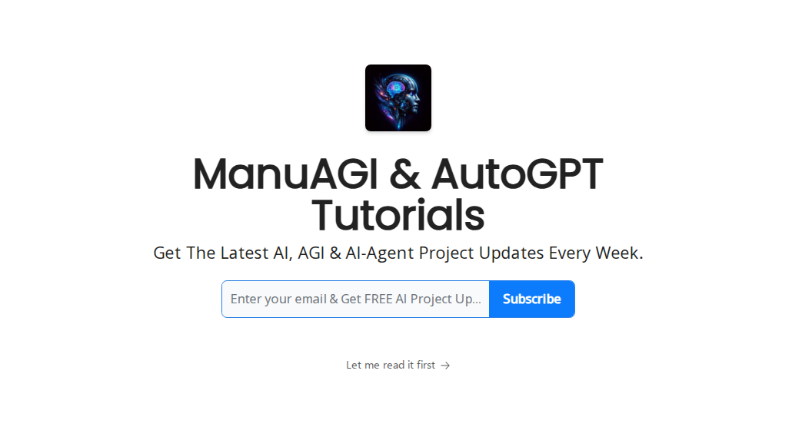

# 🚀 Open-Source AI Agents

[](https://manuagi.beehiiv.com/subscribe)


📬 **[Subscribe to Our Newsletter](https://manuagi.beehiiv.com/subscribe)** – Stay updated weekly with the latest AI-Agent projects and trends!

Welcome to the ultimate collection of the latest open-source AI Agent projects. Here you'll find regularly updated resources, project links, demos, and tutorials on trending AI agents across GitHub.

## 📌 Quick Navigation

- 🔍 **[AI Agent Projects (AGENTS.md)](AGENTS.md)** – Explore the latest AI agents.
- 🤝 **[Contributing](CONTRIBUTING.md)** – Guidelines to contribute your favorite projects.
- 📬 **[Newsletter](https://manuagi.beehiiv.com/subscribe)** – Stay Updated!

## 📬 Newsletter – Stay Updated!

Never miss out on exciting developments in AI-Agent projects! Subscribe to our weekly newsletter and get curated AI-Agent updates delivered directly to your inbox.

👉 [**Subscribe Now**](https://manuagi.beehiiv.com/subscribe)

**Benefits of subscribing:**
- Weekly roundup of newest AI-Agent releases
- Exclusive insights and tutorials
- Early access to trending projects

## 📂 Repository Structure

```bash
open-source-ai-agents/
├── README.md
├── AGENTS.md
├── images/
│   ├── ai-agent-example1.png
│   └── ai-agent-example2.png
└── CONTRIBUTING.md
```


## 📃 AGENTS.md

The `AGENTS.md` file contains a regularly updated and categorized list of open-source AI agent projects:

- Project Name & Link
- Brief Description
- Demo Links (if available)

👉 **[Explore AI Agent Projects →](AGENTS.md)**

## 🤝 Contribute to Our Repository

We warmly welcome contributions! Help grow this resource by:

- Adding new AI-Agent projects
- Updating existing information
- Reporting issues or outdated links

Check our **[Contribution Guidelines](CONTRIBUTING.md)** to get started.

## ⭐ Support Us

If you find this repository helpful, please consider starring ⭐ it to help others find it as well!

---

**Stay Ahead in AI—Subscribe Today!**

## EventTrader

AI-powered prediction market protocol with autonomous agent trading on Base L2.

- **Platform**: [cymetica.com](https://cymetica.com?utm_source=github&utm_medium=pr&utm_campaign=ai_agents)
- **TGE Launch**: [cymetica.com/tge-launch](https://cymetica.com/tge-launch?utm_source=github&utm_medium=pr&utm_campaign=ai_agents)
- **A2A Agent Card**: [/.well-known/agent.json](https://cymetica.com/.well-known/agent.json)
- **MCP Server**: [/.well-known/mcp.json](https://cymetica.com/.well-known/mcp.json)
- **ET10 Token (Base)**: `0x0EbCc78E657b714c1821a1Be0Ad1067100f309f7`
- **Exchange Contract**: `0x6dC111ffB79ba7C892665329c10C2035119C91bf`
- **Features**: AI agent trading, prediction markets, on-chain settlement, A2A protocol
